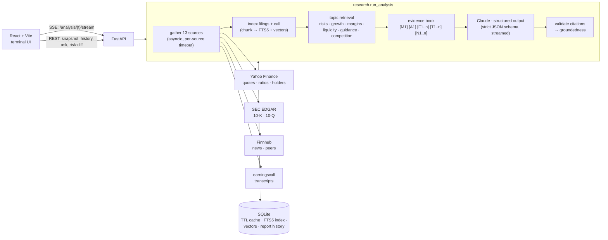

<div align="center">

# 📈 StockAnalyzer

### AI equity research terminal with retrieval over SEC filings and cited, verifiable reports

**Type a ticker. Watch 13 data sources stream in. Get an institutional-style report where every claim links back to the filing, call transcript or article it came from.**

[](https://github.com/aahilafraz123/Stock-Analyst-/actions/workflows/ci.yml)


-6E56CF)

</div>

---

## What it does

Most stock screeners show numbers. StockAnalyzer does the reading an analyst would do: the latest **10-K and 10-Q**, the **earnings call** (prepared remarks vs. analyst Q&A), **insider and institutional flows**, **Wall Street targets**, **peers** and **recent news**. It then has Claude write a structured report in which **every claim carries citations** to that evidence.

| | |
|---|---|
| 🛰️ **Live pipeline** | 13 sources fetched concurrently, streamed to the UI over Server-Sent Events as each one lands |
| 🔎 **RAG over filings** | 10-Ks, 10-Qs and transcripts are chunked and indexed (BM25 via SQLite FTS5, plus optional dense embeddings fused with reciprocal rank fusion) |
| 🧾 **Cited reports** | Every evidence block has an ID (`F3`, `T1`, `N2`…). Claude must cite IDs per claim; invented IDs are stripped and a **groundedness score** is reported |
| 💬 **Ask the filings** | Free-form questions answered with Claude's **Citations API**: sentence-level citations that link to the exact SEC passage |
| 🔁 **Risk-factor diff** | What changed in Risk Factors between the last two 10-Ks: added, removed, escalated, softened. Each quote is **verified verbatim** against the filing |
| 📊 **Track record** | Every report is stored. A scorecard compares past BUY/HOLD/SELL calls with what the stock then did vs. SPY |

> **Demo:** _add a GIF here (`docs/demo.gif`). Run the stack, analyze a ticker, and record the source panel filling in, the report with citation popovers, and an "Ask the filings" answer._

---

## Architecture



**Request flow.** The stock page loads a one-call `/snapshot` (profile, ratios, price, analysts share a single cached upstream fetch), so the dashboard paints right away. In parallel it opens an `EventSource` to `/analysis/{t}/stream`, which emits:

```
stage  sources    → source × 13 (pending → ok | empty | error | skipped, with timings)
stage  indexing   → stage retrieval → stage llm → llm thinking → llm writing (chars…) → report
```

A report generated in the last 6 hours is served from history instantly; **Regenerate** forces a fresh run.

---

## How the retrieval works

The original version pasted the first 20k characters of the 10-Q into the prompt, which in practice was mostly the table of contents. The current pipeline:

1. **Section extraction** (`services/edgar.py`). Filings are parsed by `Item N.` headings, with title checks such as "Risk Factors" or "Management's Discussion". Each heading spans to the next one and the longest span wins, so table-of-contents entries (a few characters long) lose to the real section. Part I/Part II collisions in 10-Qs (Item 2 = MD&A vs. Unregistered Sales) resolve the same way.
2. **Chunking** (`rag/chunking.py`). Paragraph-aligned chunks of about 1.4k characters with about 200 characters of overlap. Transcripts arrive as one giant line, so they fall back to sentence boundaries. Each chunk is indexed with a contextual header (`AAPL 10-K (FY ended …) | Risk Factors`).
3. **Hybrid search** (`rag/retriever.py`).
   - **BM25** via SQLite FTS5 (porter stemming), always available.
   - **Dense vectors** via Voyage `voyage-finance-2` or local `fastembed` when configured.
   - The two are fused with **reciprocal rank fusion**. At this scale no vector database is needed: brute-force cosine in numpy over 3,000 chunks × 1,024 dimensions takes about 0.3 ms per query once the matrix is cached in memory (about 50 ms for the first load from SQLite).
4. **Topic retrieval for reports.** Six queries (risks, growth, margins, liquidity, guidance, competition) pull about 18 de-duplicated passages from the *latest* 10-K, 10-Q and call. That gives targeted evidence instead of a truncated document.
5. **Grounding checks.**
   - Report citations are validated against the evidence IDs.
   - Ask-the-filings uses Claude's native Citations API (`document` blocks with `citations.enabled`).
   - Risk-diff quotes are fuzzy-matched (whitespace, case, ellipses) against the source filing and flagged `quoteVerified`.

### Evaluation

```bash
cd backend
python -m evals.retrieval_eval --fixtures          # offline synthetic corpus (CI gate: hit@5 ≥ 0.9)
python -m evals.retrieval_eval AAPL MSFT --index   # real filings, generic section-labelled questions
python -m evals.report_eval                        # groundedness / invalid-citation rate of stored reports
```

Baseline on the synthetic corpus with **BM25 only**: `hit@1 0.80 · hit@5 1.00 · MRR 0.90`. Both rank-2 misses are paraphrases ("what happens if the platform is *hacked*" vs. "*cybersecurity incidents*"), which is the case dense embeddings exist for. Run with `EMBEDDINGS=local` or a `VOYAGE_API_KEY` to compare.

---

## Getting started

### Option A: Docker (one command)

```bash
cp backend/.env.example backend/.env    # add ANTHROPIC_API_KEY and FINNHUB_API_KEY
docker compose up --build
```

Then open http://localhost:5173. API docs are at http://localhost:8000/docs.

### Option B: local dev

```bash
# backend
cd backend
python -m venv venv && source venv/bin/activate
pip install -r requirements-dev.txt          # + requirements-embeddings.txt for local dense retrieval
cp .env.example .env                         # add your keys
uvicorn app.main:app --reload --port 8000

# frontend (new terminal)
cd frontend
npm install
npm run dev                                  # http://localhost:5173
```

### Configuration

All settings are environment variables (see [`backend/.env.example`](backend/.env.example)):

| Variable | Default | Purpose |
|---|---|---|
| `ANTHROPIC_API_KEY` | — | **Required.** Report, Q&A and diff generation |
| `FINNHUB_API_KEY` | — | **Required** for news and peers ([free key](https://finnhub.io/)) |
| `SEC_USER_AGENT` | placeholder | SEC asks automated clients for a contact, e.g. `"StockAnalyzer you@example.com"` |
| `ANTHROPIC_MODEL` | `claude-opus-5-5` | Any current Claude model ID |
| `ANTHROPIC_EFFORT` | `medium` | `low` … `max`; trades depth for latency and cost |
| `ANTHROPIC_FALLBACKS` | `default` | Server-side refusal fallbacks; empty disables |
| `EARNINGSCALL_API_KEY` | demo | Without it only a handful of tickers have transcripts |
| `EMBEDDINGS` | `auto` | `auto` / `voyage` / `local` / `none` (BM25 only) |
| `VOYAGE_API_KEY` | — | Enables finance-tuned dense retrieval |
| `CORS_ORIGINS` | localhost | Comma-separated allowed origins |
| `REPORT_TTL_SECONDS` | `21600` | How long a stored report is served before regenerating |
| `DATA_DIR` | `backend/.data` | SQLite cache, retrieval index and report history |
| `VITE_API_URL` (frontend) | `http://localhost:8000` | Backend URL baked into the frontend build |

---

## API

Interactive docs at `/docs`. Errors are always JSON: `{"error": "upstream_error", "detail": "...", "source": "SEC EDGAR"}`, with 404 / 422 / 502 / 503 as appropriate.

| Method | Endpoint | Description |
|---|---|---|
| `GET` | `/analysis/{t}/stream` | **SSE**: live progress events, then the report |
| `GET` | `/analysis/{t}?refresh=` | Same report as one blocking JSON response |
| `GET` | `/stocks/{t}/snapshot` | Profile + ratios + analysts + price context in one call |
| `GET` | `/stocks/{t}/competitors` | Peer comparison (Finnhub peers, fetched concurrently) |
| `GET` | `/stocks/{t}/history?period=1Y` | OHLCV (1W … 5Y) |
| `POST` | `/rag/{t}/index` | Index recent 10-Ks, 10-Qs and calls (idempotent) |
| `GET` | `/rag/{t}/search?q=` | Raw hybrid search hits with lexical/dense ranks |
| `POST` | `/rag/{t}/ask` | Question → answer with sentence-level citations |
| `GET` | `/rag/{t}/risk-diff` | YoY Risk Factors diff with verified quotes |
| `GET` | `/reports/{t}` · `/reports/id/{id}` | Report history |
| `GET` | `/reports/track-record` | Hit rate and excess return vs. SPY |
| `GET` | `/filings/{t}` · `/filings/{t}/text` | Filing list and extracted sections |
| `GET` | `/news/{t}` · `/health` | News headlines · configuration status |

---

## Engineering notes

- **Caching.** A two-level TTL cache (in-process LRU + SQLite) wraps every fetcher. Concurrent callers for the same key share one request (single-flight), failures are briefly remembered so an outage costs one request, not four, and filed SEC documents are cached for 30 days because they never change. One analysis went from ~16 Yahoo `.info` calls and 3 downloads of SEC's ticker map to one of each.
- **Structured output.** Reports use `output_config.format` with a strict JSON schema generated from Pydantic models (refs inlined, `additionalProperties: false`), so parsing can't fail on prose or code fences. Field descriptions double as instructions. The call is streamed (long inputs, live progress), and `refusal` / `max_tokens` stop reasons raise typed errors.
- **Failure isolation.** Each source has its own timeout and reports `ok | empty | error | skipped`. A missing key disables one source, not the report. The prompt and the UI both say which evidence was unavailable.
- **Errors that make sense in a browser.** Exceptions become JSON *inside* the CORS middleware. Previously an upstream failure surfaced in devtools as a misleading CORS error.
- **Zero infrastructure.** Everything persistent is one SQLite file in WAL mode. Schema setup is serialized because concurrent first connections racing on `PRAGMA journal_mode=WAL` was a real bug the test suite caught.

### Tests & CI

```bash
cd backend && pytest --cov=app      # 59 tests, fully offline (synthetic filings, fake Claude client)
cd frontend && npm test && npm run lint && npm run build   # 36 tests (vitest + Testing Library)
```

GitHub Actions runs ruff (lint and format), pytest, the retrieval-eval gate, frontend lint/test/build, and a `docker compose build`.

### Deploying

[`render.yaml`](render.yaml) is a Render Blueprint: a Docker web service for the API (with an optional persistent disk for `/data`) and a static site for the frontend. After the first deploy, set the frontend's `VITE_API_URL` and the backend's `CORS_ORIGINS` to each other's URLs.

---

## Project structure

```
backend/
  app/
    main.py              app, error middleware, CORS, routers
    config.py            env-driven settings
    cache.py  db.py      TTL cache with single-flight · shared SQLite
    llm.py               Claude: strict-schema structured output (streamed), cited answers
    schemas.py           report / diff models (also the JSON schema sent to Claude)
    routers/             stocks · news · filings · analysis (SSE) · rag · reports
    services/
      research.py        ⭐ pipeline: sources → index → retrieve → Claude → validate
      edgar.py           SEC filing discovery + Item-heading section extraction
      market_data.py     yfinance quotes, ratios, history, analysts, peers
      news.py  transcripts.py  insider.py  institutional.py  peers.py  history.py
    rag/
      chunking.py  store.py (FTS5 + vectors)  embeddings.py  retriever.py (RRF)
      ingest.py  qa.py (Citations API)  diff.py (risk-factor diff + quote check)
  evals/                 retrieval_eval.py · report_eval.py · questions.json
  tests/                 pytest suite + synthetic 10-K / 10-Q fixtures
frontend/
  src/pages/             SearchPage · StockPage · TrackRecordPage (lazy-loaded routes)
  src/components/        AnalysisPanel · SourceProgress · AnalysisReport · CitationChip · AskFilings ·
                         RiskDiff · ReportHistory · PriceChart · CompetitorTable · …
  src/hooks/             useAnalysisStream (EventSource lifecycle) · useRequest (keyed, abortable fetches)
  src/state/             analysisStream reducer (pure, unit-tested)
```

---

## Limitations & roadmap

- Yahoo Finance data comes from an unofficial API and can rate-limit. Caching softens this but doesn't remove it.
- Section labels in the retrieval eval are a coarse relevance proxy. Hand-labelled passages would give a sharper signal.
- The track record needs time (and reports) to mean anything. It's a sanity check, not a backtest.
- Next: XBRL financial statements from SEC's `companyfacts` API, multi-ticker comparison, watchlists with scheduled re-analysis, and a reranker over the fused candidates.

## ⚠️ Disclaimer

StockAnalyzer is a **research and educational tool**. Its output is AI-generated and may contain errors or omissions. **Nothing here is financial advice.** Do your own due diligence and consult a licensed professional before making investment decisions.

<div align="center">

**Built with FastAPI, React and Claude.** *Reads the filings so you don't have to, and shows its work.*

</div>
